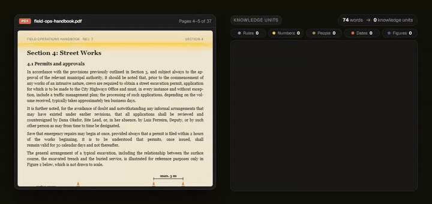
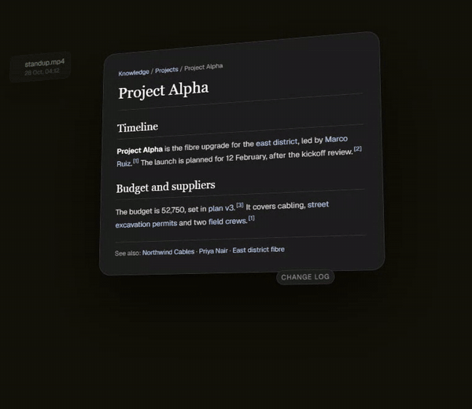
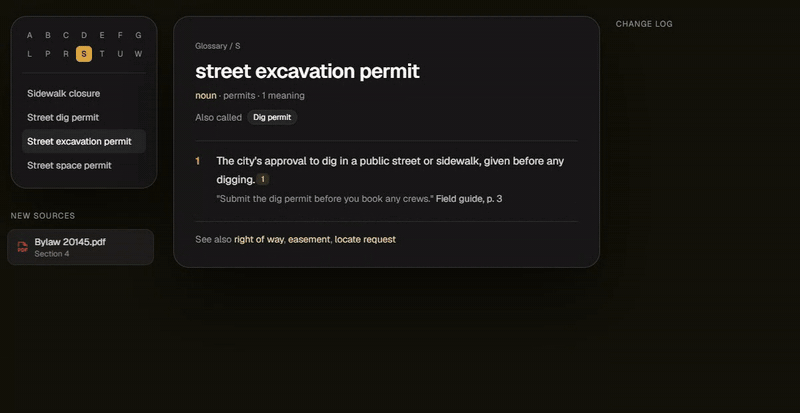
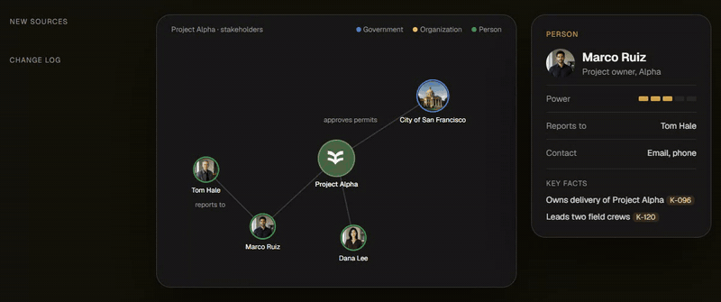
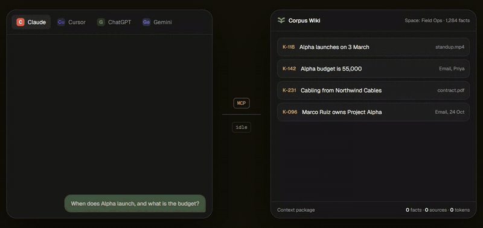
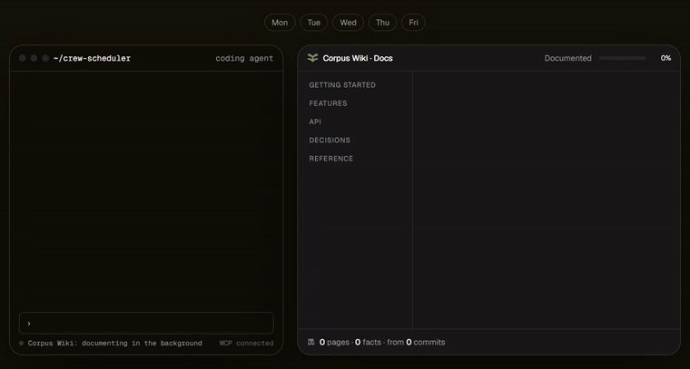
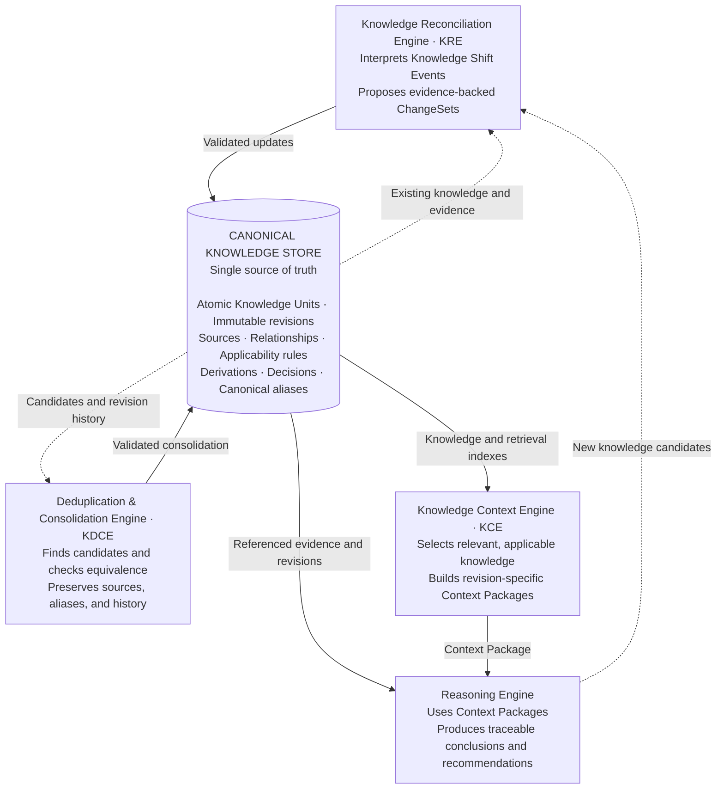

<div align="center">

<picture>
  <source media="(prefers-color-scheme: dark)" srcset="public/brand/corpus-wiki/Corpus-Wiki-Horizontal-RGB-White.svg">
  
</picture>

### Your automated knowledge base

Add your files. Corpus Wiki sorts them out, writes simple pages for your team and keeps them up to date.

[](https://nextjs.org)
[](https://react.dev)
[](https://supabase.com)
[](https://build.nvidia.com/nvidia)
[](https://tokenfactory.nebius.com)
[](LICENSE)

[Features](#features) · [How it works](#how-it-works) · [Use cases](#use-cases) · [Nemotron](#how-it-uses-nvidia-nemotron-on-nebius-token-factory) · [Run it locally](#run-it-locally) · [Architecture](#architecture)

<br>


</div>

> [!NOTE]
> **Hackathon:** Corpus Wiki is a submission to the [Nebius Global AI Hackathon](https://nebiusglobalaihackathon.devpost.com/). It is a working prototype: upload a PDF, Word or Markdown file, NVIDIA Nemotron drafts what it changes, Change control applies it or asks a person, and only the wiki lines that changed are rewritten.

## Why

Maintaining, updating and organizing knowledge is **hard**. Docs go stale the day they are written, two files disagree and nobody notices, and nobody can say where a sentence came from.

**So Corpus Wiki does it for you.** Every line knows its source, changes when its source changes, and goes through a human check when it matters.

```text
Messy data                         Corpus Wiki                          What you get
docs · images · video  ──▶  convert → split → extract  ──▶  wiki pages · glossary
links · notes · API         → reconcile → check → build       stakeholders · agent memory
```

## How it works

1. **Feed it.** Upload a document, or send one through the Capture API.
2. **It updates.** AI turns it into short, sourced facts and rewrites only what changed.
3. **You check.** It asks you only when it isn't sure: conflicts, deletions, merges.

### From long PDFs to clear facts

Every page is read, pictures included. Each fact comes out short, with its source.

<p align="center"></p>

### Pages that rewrite themselves

A new file arrives. Only the sentences it changes are rewritten, each with its source, and every change lands in the change log with an undo.

<p align="center"></p>

### A glossary written by your files

Every term your documents use, defined in plain words, with real examples from your sources. Duplicates merge; new meanings add themselves.

<p align="center"></p>

### Know who matters, and why

Every person and organization in your files, how they connect and how much say they have (a 1 to 5 power level). Kept current.

<p align="center"></p>

### One memory for every agent

Connect your AI tools through MCP. They read sourced, current facts and remember what you teach them, across every session.

<p align="center"></p>

### Just build. Docs write themselves.

While you work with your coding agent, every feature, endpoint and decision is documented in the background.

<p align="center"></p>

## You stay in charge

| | |
| --- | --- |
| 🔗 **Every line has a source** | Every sentence links to the file and the page it came from. |
| ✋ **Risky changes wait for you** | Safe updates apply on their own. Conflicts and deletions wait for a person. |
| ↩️ **Undo anything** | Every change is recorded with its cause and can be reversed. |
| 🧩 **One answer, not ten versions** | Matching facts merge into one, and every source stays attached. |

## Features

<table>
<tr>
<td valign="top" width="50%">

**📥 Getting knowledge in**

- **Upload** (`/upload`): PDF, Word, Markdown, text and notes, with cancel and retry
- **Capture API** (`POST /api/capture`): a note or file from a script, shortcut or agent in one request
- **MCP server** (`/api/mcp`): outside agents read and edit a Space with scoped OAuth tokens or personal keys *(in progress)*
- **Web search for thin sections**: Composer may fill gaps from the web, or stick to your files
- **Entity research**: logos, descriptions and Wikidata sizes for the entities your files mention

</td>
<td valign="top" width="50%">

**✍️ AI that writes and tidies the wiki**

- **Composer**: writes articles and sections from the facts, with Wikimedia images or SVG diagrams
- **Curator**: merges, moves and splits pages; unsure changes wait for a person
- **Domain organiser**: builds and fixes the topic tree
- **Deduplicator**: finds repeated facts, terms, entities and domains
- **Reviewer**: fact-checks lines and reviews whole pages
- **Article charter** and **role memory**: who the wiki is for, and notes each AI role keeps

</td>
</tr>
<tr>
<td valign="top">

**📖 Reading and sharing**

- **Wiki pages** (`/p/<slug>`): live lines with citations; click a line for its facts, sources and history
- **Ask and Chatbot** (`/ask`, `/chatbot`): answers from the facts; Agent mode can also make changes
- **Publishing**: private, unlisted or public editions, read at `/s/<space>`
- **Explore** (`/explore`) and **Embed** (`/embed/<space>`): a public directory and a read-only iframe
- **Read statistics**: views, engaged reads and popular articles, with no analytics cookies

</td>
<td valign="top">

**🔍 Reviewing and browsing**

- **Changes** (`/changes`): every applied ChangeSet, with a diff and undo
- **Exceptions** (`/exceptions`): decisions the AI won't make alone
- **Units, Sources, Entities, Domains**: every fact, file, thing and topic
- **Graph** (`/graph`): a map of facts and entities with cleanup and undo
- **Glossary, Decisions, Stakeholders, Assets**: terms, commitments, people and images
- **Error log** and **processing recovery** for stuck uploads and builds

</td>
</tr>
</table>

Also: Spaces (separate wikis), per-role AI model settings, usage plans and limits, a guided tour, evals, and a cost report per role and model. The full list is in [docs/features.md](docs/features.md).

## Use cases

| Use case | Why it fits |
| --- | --- |
| 📘 **Self-maintaining docs** | Handbooks, policies and project pages update when a new file changes the rules; every step links to its source. |
| 🧠 **Your life's wiki** | Notes, chats, lectures, plans and friends, sorted into one wiki about you. |
| 🤝 **Client tracking** | Every client's details, deal stage and last talk, kept current from emails and calls. |
| 📚 **Learning a big subject** | Long books become linked, sourced pages in minutes, with repeats merged. |
| ⚖️ **Rules and compliance** | Dated sources, newer overrides older, same-date conflicts go to a person, every change is logged. |
| 🤖 **Memory for AI agents** | One sourced memory your AI tools read and write over MCP, with the same Change control as people. |

## How it compares

- **Notion, Confluence:** people keep pages current; AI helps write but does not update pages when facts change.
- **NotebookLM, ChatGPT with files:** answer from files but build no lasting wiki, merge nothing and track no changes.
- **Glean, Guru:** find documents but do not settle conflicts between them or rewrite them.
- **Mem0 and other agent memory:** store facts for agents, but not as a readable wiki and with no review step.

## Under the hood

### What the prototype does

One Next.js App Router app (UI and server code) on Vercel. Supabase provides Postgres, Realtime, Storage and the login. Browsers only read (row-level security); server code writes with the secret key, and every write is a Postgres function.

**One upload pipeline, one converter per format** (`lib/ingest`):

| Format | Converter |
| --- | --- |
| PDF | `unpdf` (text per page) |
| Word (.docx) | `mammoth` |
| Markdown and plain text | read as text |
| Images, audio, video | slots only; not converted yet |

The file is stored in the private `sources` bucket, split into passages, and recorded with a Knowledge Shift Event (`ingest_source`). A file with the same bytes is skipped.

**Reconciliation** (`lib/ai`): Nemotron reads the passages and the current knowledge and drafts a ChangeSet of typed actions (create domain or entity, add, revise or retire a claim, merge duplicates, link, set certainty). Details in [How it uses NVIDIA Nemotron](#how-it-uses-nvidia-nemotron-on-nebius-token-factory).

**Change control** (`lib/change-control`, `supabase/migrations/20261014010000_change_control.sql`): `commit_change_set` checks and applies a ChangeSet in one transaction. Everything that passes is applied without asking (approval by exception). A person is asked only when:

- two sources of the same date disagree,
- a proposal or question would overwrite a decision,
- the AI wants to retire or merge knowledge,
- the AI drafts domains for the first time (the tree is reviewed once).

An older file never overwrites a newer one, and a set whose units changed while it was drafted is refused as a whole. Every applied ChangeSet can be undone from the Changes screen.

**Living pages, lines as rows** (`lib/living-page`, `supabase/migrations/20261015000000_lines_as_rows.sql`): every line of a wiki section is a row (`lines`) with never-edited versions (`line_revisions`) that cite the exact claim revisions they state. When a claim changes, the lines citing it are flagged (`stale_lines`), and only those lines are rewritten, through Change control like any other change. Editing a line that states one claim also revises that claim in the same ChangeSet, so changes flow both ways. Open pages update live.

**One call** (`app/api/capture/route.ts`): `POST /api/capture` runs the whole path above in a single request and answers with the event's status and ChangeSet, so a script, phone shortcut or another agent can feed the wiki without the UI. Send a note as JSON (`text`, optional `title` and `sourceDate`), raw text, or a file as multipart (`file`, optional `sourceDate`); the date defaults to today. Authenticate with `Authorization: Bearer $SECOND_BRAIN_API_KEY` or a signed-in session.

```bash
curl -X POST http://localhost:3000/api/capture \
  -H "Authorization: Bearer $SECOND_BRAIN_API_KEY" \
  -H "Content-Type: application/json" \
  -d '{"title":"Alpha standup","text":"Alpha moves its launch to 3 March."}'
```

**Screens:** Home, Upload, Changes (with undo), Exceptions, Units, Sources, Entities, Domains, and the wiki pages (`/p/<slug>`). Click a line to see the claims behind it, their sources and the line's history.

**Tables:** `sources`, `passages`, `shift_events`, `domains`, `entities`, `units`, `revisions`, `unit_entities`, `unit_domains`, `relationships`, `change_sets`, `actions`, `exceptions`, `pages`, `sections`, `section_inputs`, `change_notes`, `lines`, `line_revisions`; views `stale_lines` and `section_lines`.

## How it uses NVIDIA Nemotron on Nebius Token Factory

The AI steps run on **NVIDIA Nemotron (`nvidia/nemotron-3-super-120b-a12b`)** served by **Nebius Token Factory**, called at runtime through Token Factory's OpenAI-compatible API (`https://api.tokenfactory.nebius.com/v1/`).

### What Nemotron does

1. **Reconciliation.** For each uploaded file, the server sends Nemotron one request with the file's passages (each with its id and the file's source date) and the current knowledge: units, domain paths and entities, so the model can match new claims to existing ones without a vector index. Nemotron returns a **draft ChangeSet**: typed actions, each citing the passages that support it and tagging how the claim was said (stated, decided, proposed or asked).
2. **Writing wiki lines.** After a commit, Nemotron rewrites only the lines whose claims changed and writes lines for claims no line states yet, citing claims by short refs (C1, L1) so it cannot invent ids.

### What Nemotron does not do

The model never writes knowledge. Its draft goes to `commit_change_set`, a Postgres function that checks every action and applies the ChangeSet in one transaction (see [What the prototype does](#what-the-prototype-does)); anything that needs judgement becomes an exception for a person. Each ChangeSet records the model id and prompt version that drafted it, so a bad batch can be traced and undone.

### Where the code is

| What | Where |
| --- | --- |
| Provider settings (base URL, default model, prompt version) | `lib/ai/config.ts` |
| Chat call with a JSON schema, and settings from env | `lib/ai/chat.ts` |
| Reconciliation prompt, answer schema and mapping to typed actions | `lib/ai/tokenFactory/` |
| Picks the real client when `NEBIUS_API_KEY` is set, the fake one otherwise | `lib/ai/factory.ts` |
| Wiki line writer | `lib/living-page/writers/tokenFactory.ts` |
| Fake clients used by tests and offline development | `lib/ai/fake/`, `lib/living-page/writers/fake.ts` |
| End-to-end eval cases E1–E7 | `evals/` |

### Configuration

Set these in `.env.local` (local) or in Vercel's environment settings (deployed). Never commit them.

```bash
NEBIUS_API_KEY=   # from Nebius Token Factory
AI_MODEL=nvidia/nemotron-3-super-120b-a12b   # optional; this is the default
```

### How Token Factory helped

- **OpenAI-compatible API:** the client is a plain chat-completions call, so the provider sits behind one small interface and the rest of the app never knows which model is used.
- **Structured output:** `response_format: {"type": "json_schema"}` with the answer's JSON schema constrains the output on the server; the app still validates it with zod before anything is committed.
- **Several Nemotron sizes behind one key:** switching model size is a change to `AI_MODEL`.

## Run it locally

```bash
cp .env.example .env.local   # fill in the keys; never commit .env.local
npm ci
npm run dev                  # http://localhost:3000, redirects to /login when signed out
```

Sign in with your Supabase Auth user. Without `NEBIUS_API_KEY` the app uses fake AI clients that answer the eval fixtures, so the UI and tests run without a key.

```bash
npm run build
npm run typecheck
npm run lint
npm test           # vitest; DB tests start a throwaway Postgres 16 (see below)
npm run db:types   # prints how to regenerate lib/database/types.ts
npm run db:migrate # applies pending supabase/migrations to the Supabase database (see below)
```

<details>
<summary><b>Development notes: schema, migrations, tests, evals</b></summary>

- **Schema**: `supabase/migrations/` is the source of truth, applied in file-name order. Never edit an applied migration; add a new file. Don't put `begin`/`commit` in a migration; the runner wraps each file in its own transaction. `lib/database/types.ts` is generated from the live schema.
- **Applying migrations**: `npm run db:migrate` (`scripts/db/migrate.ts`) sends each pending file as one script that opens a transaction, takes a lock, records the file in `supabase_migrations.schema_migrations`, runs it and commits, so a failed file leaves nothing behind. It reaches the database one of two ways (`scripts/db/targets.ts`): with `SUPABASE_ACCESS_TOKEN` (a personal access token) it uses Supabase's Management API over HTTPS, which is the only route that works from Claude's cloud sessions, since they pass HTTPS traffic only; otherwise it connects straight to Postgres with `SUPABASE_DB_URL` (dashboard > Connect > Session pooler, port 5432), verified against Supabase's root CA in `supabase/certs/`. `-- --status` lists applied and pending files; `-- --baseline <version>` records files up to that version as applied without running them (for a database whose schema was built another way). Schema changes go through this path, not the Supabase connector, whose confirmation prompt for `DROP`/`DELETE` can't be answered from a Claude thread.
- **Seed**: `supabase/seed.sql` is the Project Alpha baseline the tests and evals start from.
- **DB tests**: `test/db/localPostgres.ts` creates a socket-only cluster in `/var/tmp` with the binaries in `/usr/lib/postgresql/16/bin` (override with `PG_BIN`), stubs Supabase's `auth`, `storage`, Realtime publication and API roles, applies every migration and the seed, and deletes it afterwards. The tests skip when the binaries are missing.
- **Evals**: `evals/cases.ts` lists E1–E7 and `evals/fixtures/` holds the dated files. `evals/evals.test.ts` runs each case through the real pipeline with the fake model. `LIVE_FILE=<path> npx vitest run evals/live.test.ts` sends one real file through Nemotron.
- **Lockfile**: generated with npm 11 (`npx npm@11 install`), because npm 10.9 crashes resolving vitest 5's optional peers. `npm ci` works with npm 10 and 11.
- **UI components**: `components/ui` holds jayrr.dev registry components; `lib/standard-lint.mjs` is jayrr.dev's standard lint (theme colors only, sizes through props), wired into `eslint.config.mjs`.
- **Colors and type**: only the tokens in `app/globals.css` (grayscale plus five muted accents). Font sizes are `text-panel`, `text-body` and `text-title`; muted text is `text-muted-foreground` or `text-faint`.

</details>

## Architecture

> Store information to preserve evidence. Structure knowledge to support understanding. Retrieve knowledge to support decisions and actions.

Build a wiki that can explain what it knows, where that knowledge came from, when it applies, how it connects to other knowledge, and why it influenced a conclusion or decision.

Documents preserve evidence. Atomic Knowledge Units (AKUs) represent independently understandable claims, concepts, principles, procedures, hypotheses, or questions. Typed relationships connect them into a versioned knowledge graph.

New evidence should trigger incremental reconciliation. Questions should assemble task-specific context. Equivalent claims should consolidate without losing their sources or history. Conclusions, decisions, and observed outcomes should feed future learning while retaining their distinct meanings.

The canonical knowledge store sits at the center of four engines. Arrows summarize responsibilities; every canonical write passes through validation.



### The four engines

| Engine | Responsibility | Primary output |
| --- | --- | --- |
| Knowledge Reconciliation Engine (KRE) | Interpret incoming events, extract knowledge, identify contradictions, and analyze impact | Proposed Knowledge ChangeSet |
| Deduplication & Consolidation Engine (KDCE) | Find similar units, verify claim equivalence across context, entities, and time, and propose safe consolidation | Consolidation or relationship proposal |
| Knowledge Context Engine (KCE) | Interpret a task, retrieve candidates, evaluate applicability, expand evidence and dependencies, and identify gaps | Context Package referencing specific revisions |
| Reasoning Engine | Evaluate the package, request more context when needed, and preserve the derivation behind each conclusion | Conclusions, recommendations, and decision proposals |

### Knowledge and supporting infrastructure

The store preserves AKUs, immutable revisions, source records, typed relationships, applicability rules, derivations, decisions, and aliases. Metadata records knowledge type, status, provenance, authority, scope, timestamps, and uncertainty where justified.

Vector embeddings, keyword indexes, structured queries, and graph traversal support retrieval. Embeddings belong to specific revisions and can be regenerated; they do not replace canonical knowledge.

An event-driven processing layer handles execution state, retries, idempotency, revision checks, validation, dependency propagation, embedding refresh, and real-time notifications. Approval blocks operations that require it while permitted processing continues.

<details>
<summary><b>Core axioms</b></summary>

These axioms summarize the principles developed for the project.

> **Open point:** the design documents use a list of **12** fundamental axioms; this README lists **17**. Both are kept until Sam decides which list is canonical.

1. **Knowledge is atomic and composable.** Each unit expresses one primary idea. Higher-level explanations, models, and procedures retain references to their underlying units.
2. **Information is not automatically established knowledge.** Preserve raw evidence separately from interpretations and derived claims.
3. **Identity is stable.** Knowledge IDs survive revisions, renaming, and consolidation.
4. **Provenance is preserved.** Claims retain their sources, evidence, capture context, and derivation method where applicable.
5. **History is immutable.** Corrections create new revisions. Historical conclusions and decisions remain reproducible.
6. **Applicability is explicit.** A claim records its scope, assumptions, conditions, exceptions, and relevant validity periods. Missing context remains unknown.
7. **Relationships carry meaning.** Use typed links such as supports, contradicts, depends-on, derives-from, and supersedes.
8. **Uncertainty remains visible.** Distinguish supported claims, hypotheses, assumptions, disputed knowledge, and unknowns. Preserve contradictions for evaluation.
9. **Retrieval is contextual.** Relevance depends on the task. Evaluate applicability, evidence, authority, time, and dependencies alongside semantic similarity.
10. **Reasoning records its context.** Significant conclusions retain the specific revisions, premises, constraints, and counterevidence used. Context selection can be revised.
11. **Material changes are traceable events.** Knowledge Shift Events identify their cause, scope, affected knowledge, and resulting changes.
12. **Autonomous updates have bounded authority.** AI proposes evidence-backed ChangeSets. Deterministic validation and authorized transactions control canonical updates.
13. **Evolution is incremental and idempotent.** Reprocessing an event must not duplicate changes. Changed premises trigger review of affected contexts and derivations.
14. **Similarity does not establish equivalence.** Consolidation requires matching claims and applicability conditions, preserves sources and historical identities, and is reversible.
15. **Decisions and truth have separate lifecycles.** A decision fact records a commitment, not proof that it was correct. Reasoning outputs cannot become independent evidence for themselves.
16. **Ownership and boundaries are enforced.** Capture, retrieval, reasoning, and sharing respect access permissions.
17. **Storage is independent of presentation.** Reusable knowledge can support notes, documents, diagrams, and AI context without duplicating canonical claims. Retention prioritizes useful evidence and knowledge.

</details>

<details>
<summary><b>Main workflows: publishing, capture, reasoning and learning</b></summary>

#### Publish and share a wiki

Open **Publishing** in the sidebar to choose **Private**, **Unlisted** (anyone with the link), or **Public** (also listed in `/explore`). Select up to 100 pages, preview the visitor text, and publish a reviewed edition. Later edits and newly created pages stay private until republished. Source files, private citations, images, attachments, and workspace tools are excluded from this first version.

Enable embedding to copy a read-only wiki iframe for another website. Public readers use `/s/[spaceSlug]`; embeds use `/embed/[spaceSlug]`. Both read only the published projection, without a workspace session. Unpublishing or deleting a space disables its reader, embeds, and Explore listing. Existing copies cannot be recalled. Both public and unlisted editions request no search-engine indexing.

The owner-only Publishing screen reports views, daily browser-tab sessions, engaged reads (30 visible seconds), embed views, Explore-attributed views, and popular articles for 7, 30, or 90 UTC calendar days. Repeated views are deduplicated per article, tab, surface, and 30-minute period. Known bots and signed-in owner visits are excluded; browser privacy preferences and blocked storage can reduce counts. No analytics cookies or raw IP addresses are stored. Older event rows are removed when new reads or owner metrics are processed.

Apply database migrations with `npm run db:migrate` before running these routes. Public access is through narrow read RPCs; workspace tables retain their existing ownership rules, and public page URLs reject write requests.

#### Capture, reason, and learn

**Capture and update**

Source → preserved evidence → Knowledge Shift Event → KRE → KDCE checks for new or revised units → validated ChangeSet → canonical store.

**Retrieve and reason**

Question + situation → KCE → Context Package → Reasoning Engine → conclusion or recommendation → authorized decision when accepted.

**Learn and re-evaluate**

Committed revision → dependency analysis → affected contexts and derivations marked stale → context rebuilding and reconciliation as needed.

Derived claims, decision facts, and observed outcomes re-enter through the same update pipeline. An accepted decision remains in effect until an authorized change supersedes it, even if its supporting derivation needs review.

For near-real-time ingestion, validated provisional units may be available while consolidation runs asynchronously. Provisional status remains explicit.

</details>

<details>
<summary><b>Consolidation policy</b></summary>

Use exact hashes, vector similarity, entity matching, and graph relationships to find a small candidate set. Then evaluate claim equivalence, scope, applicability, time, and provenance.

- Consolidate verified equivalents under a canonical identity.
- Keep related claims, broader or narrower claims, contextual variants, and contradictions distinct and linked.
- Preserve original IDs, evidence, revisions, and relationships.
- Validate relationship redirection and concurrent revisions.
- Calibrate automatic consolidation thresholds against representative pairs; similarity scores alone never authorize a merge.

</details>

This architecture was developed in the [original Corpus Wiki design conversation](https://chatgpt.com/share/6acfbc17-10bc-83e8-a984-7d6bdb7cdaed).

## License

Apache License 2.0. See [LICENSE](LICENSE) and [NOTICE](NOTICE).
