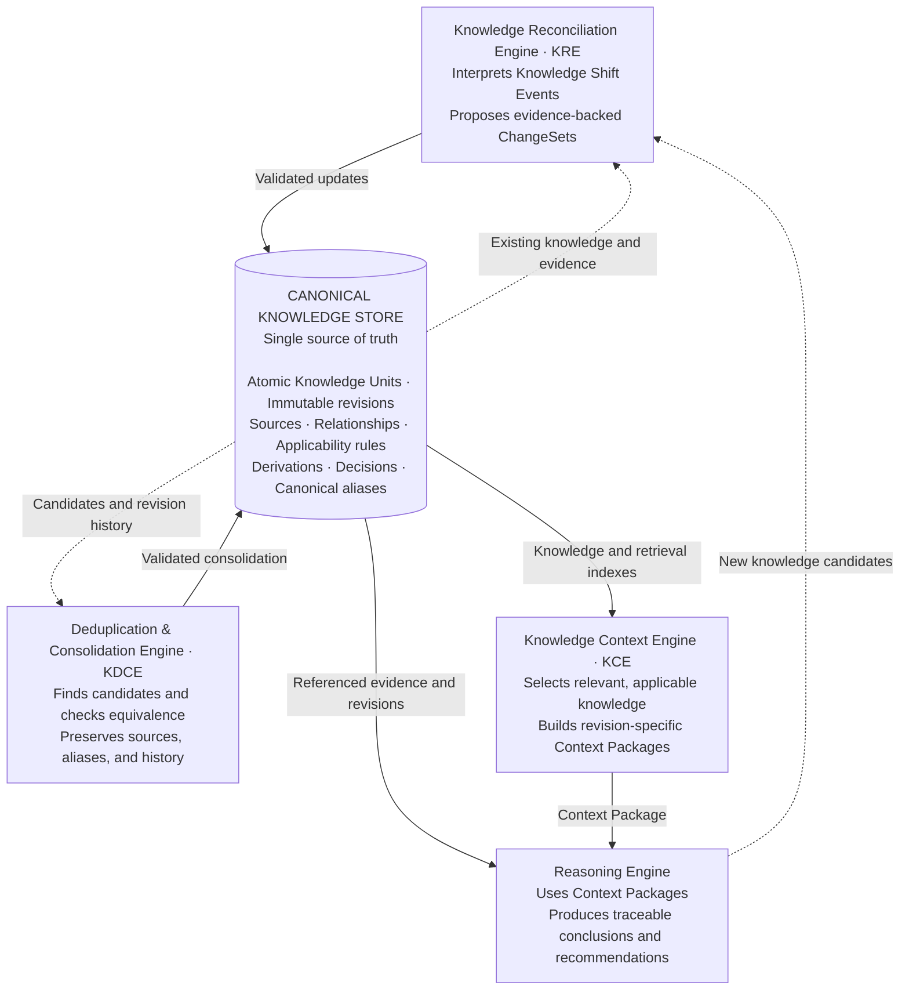

# Second Brain Engine

An evolving knowledge system that turns information into traceable, reusable knowledge—and uses that knowledge to support reasoning and decisions.

**Status:** Concept and architecture. This repository currently contains design documentation; the engine is not implemented yet.

## Vision

Build a second brain that can explain what it knows, where that knowledge came from, when it applies, how it connects to other knowledge, and why it influenced a conclusion or decision.

Documents preserve evidence. Atomic Knowledge Units (AKUs) represent independently understandable claims, concepts, principles, procedures, hypotheses, or questions. Typed relationships connect them into a versioned knowledge graph.

New evidence should trigger incremental reconciliation. Questions should assemble task-specific context. Equivalent claims should consolidate without losing their sources or history. Conclusions, decisions, and observed outcomes should feed future learning while retaining their distinct meanings.

> Store information to preserve evidence. Structure knowledge to support understanding. Retrieve knowledge to support decisions and actions.

## Core axioms

These axioms summarize the principles developed for the project.

1. **Knowledge is atomic and composable.** Each unit expresses one primary idea. Higher-level explanations, models, and procedures retain references to their underlying units.
2. **Information is not automatically established knowledge.** Preserve raw evidence separately from interpretations and derived claims.
3. **Identity is stable.** Knowledge IDs survive revisions, renaming, and consolidation.
4. **Provenance is preserved.** Claims retain their sources, evidence, capture context, and derivation method where applicable.
5. **History is immutable.** Corrections create new revisions. Historical conclusions and decisions remain reproducible.
6. **Applicability is explicit.** A claim records its scope, assumptions, conditions, exceptions, and relevant validity periods. Missing context remains unknown.
7. **Relationships carry meaning.** Use typed links such as supports, contradicts, depends-on, derives-from, and supersedes.
8. **Uncertainty remains visible.** Distinguish supported claims, hypotheses, assumptions, disputed knowledge, and unknowns. Preserve contradictions for evaluation.
9. **Retrieval is contextual.** Relevance depends on the task. Evaluate applicability, evidence, authority, time, and dependencies alongside semantic similarity.
10. **Reasoning records its context.** Significant conclusions retain the specific revisions, premises, constraints, and counterevidence used. Context selection can be revised.
11. **Material changes are traceable events.** Knowledge Shift Events identify their cause, scope, affected knowledge, and resulting changes.
12. **Autonomous updates have bounded authority.** AI proposes evidence-backed ChangeSets. Deterministic validation and authorized transactions control canonical updates.
13. **Evolution is incremental and idempotent.** Reprocessing an event must not duplicate changes. Changed premises trigger review of affected contexts and derivations.
14. **Similarity does not establish equivalence.** Consolidation requires matching claims and applicability conditions, preserves sources and historical identities, and is reversible.
15. **Decisions and truth have separate lifecycles.** A decision fact records a commitment, not proof that it was correct. Reasoning outputs cannot become independent evidence for themselves.
16. **Ownership and boundaries are enforced.** Capture, retrieval, reasoning, and sharing respect access permissions.
17. **Storage is independent of presentation.** Reusable knowledge can support notes, documents, diagrams, and AI context without duplicating canonical claims. Retention prioritizes useful evidence and knowledge.

## Architecture

The canonical knowledge store sits at the center of four engines. Arrows summarize responsibilities; every canonical write passes through validation.

### The four engines

| Engine | Responsibility | Primary output |
| --- | --- | --- |
| Knowledge Reconciliation Engine (KRE) | Interpret incoming events, extract knowledge, identify contradictions, and analyze impact | Proposed Knowledge ChangeSet |
| Deduplication & Consolidation Engine (KDCE) | Find similar units, verify claim equivalence across context, entities, and time, and propose safe consolidation | Consolidation or relationship proposal |
| Knowledge Context Engine (KCE) | Interpret a task, retrieve candidates, evaluate applicability, expand evidence and dependencies, and identify gaps | Context Package referencing specific revisions |
| Reasoning Engine | Evaluate the package, request more context when needed, and preserve the derivation behind each conclusion | Conclusions, recommendations, and decision proposals |

### Knowledge and supporting infrastructure

The store preserves AKUs, immutable revisions, source records, typed relationships, applicability rules, derivations, decisions, and aliases. Metadata records knowledge type, status, provenance, authority, scope, timestamps, and uncertainty where justified.

Vector embeddings, keyword indexes, structured queries, and graph traversal support retrieval. Embeddings belong to specific revisions and can be regenerated; they do not replace canonical knowledge.

An event-driven processing layer handles execution state, retries, idempotency, revision checks, validation, dependency propagation, embedding refresh, and real-time notifications. Approval blocks operations that require it while permitted processing continues.

## Main workflows

**Capture and update**

Source → preserved evidence → Knowledge Shift Event → KRE → KDCE checks for new or revised units → validated ChangeSet → canonical store.

**Retrieve and reason**

Question + situation → KCE → Context Package → Reasoning Engine → conclusion or recommendation → authorized decision when accepted.

**Learn and re-evaluate**

Committed revision → dependency analysis → affected contexts and derivations marked stale → context rebuilding and reconciliation as needed.

Derived claims, decision facts, and observed outcomes re-enter through the same update pipeline. An accepted decision remains in effect until an authorized change supersedes it, even if its supporting derivation needs review.

For near-real-time ingestion, validated provisional units may be available while consolidation runs asynchronously. Provisional status remains explicit.

## Consolidation policy

Use exact hashes, vector similarity, entity matching, and graph relationships to find a small candidate set. Then evaluate claim equivalence, scope, applicability, time, and provenance.

- Consolidate verified equivalents under a canonical identity.
- Keep related claims, broader or narrower claims, contextual variants, and contradictions distinct and linked.
- Preserve original IDs, evidence, revisions, and relationships.
- Validate relationship redirection and concurrent revisions.
- Calibrate automatic consolidation thresholds against representative pairs; similarity scores alone never authorize a merge.

## Design discussion

This architecture was developed in the [original Second Brain design conversation](https://chatgpt.com/share/6acfbc17-10bc-83e8-a984-7d6bdb7cdaed).
